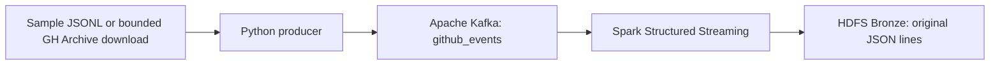
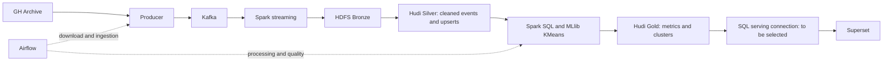

# IL-05 architecture

## Running in v0.1

Docker Compose starts Kafka, a topic initializer, an HDFS NameNode and DataNode,
an HDFS directory initializer, a Spark dependency-cache initializer, the streaming
job, and a one-shot sample producer.
The streaming consumer starts at earliest offsets, so it can read the sample even
if the producer finishes first. Everything belongs to the Compose project `il05`.

HDFS is an explicit option in the general guide. The first development machine
already has the Hadoop images, so this choice avoids downloading another storage
service. Spark uses `local[2]` inside its container for the first laptop demonstration;
there is no distributed Spark worker cluster yet.

## Required final architecture

The full architecture is a target, not a claim that these services already exist.
All later services must be integrated into the same `docker-compose.yml`.

## Technical references

- GH Archive format and hourly naming: https://www.gharchive.org/
- GitHub event common fields: https://docs.github.com/en/rest/using-the-rest-api/github-event-types
- Kafka image: https://kafka.apache.org/39/getting-started/docker/
- Kafka single-node example: https://github.com/apache/kafka/tree/3.9.1/docker/examples/docker-compose-files
- Spark Kafka integration: https://spark.apache.org/docs/3.5.7/structured-streaming-kafka-integration.html
- Hadoop container configuration: https://github.com/big-data-europe/docker-hadoop
- Hudi 0.15 supports Spark 3.5: https://hudi.apache.org/docs/0.15.0/quick-start-guide/
